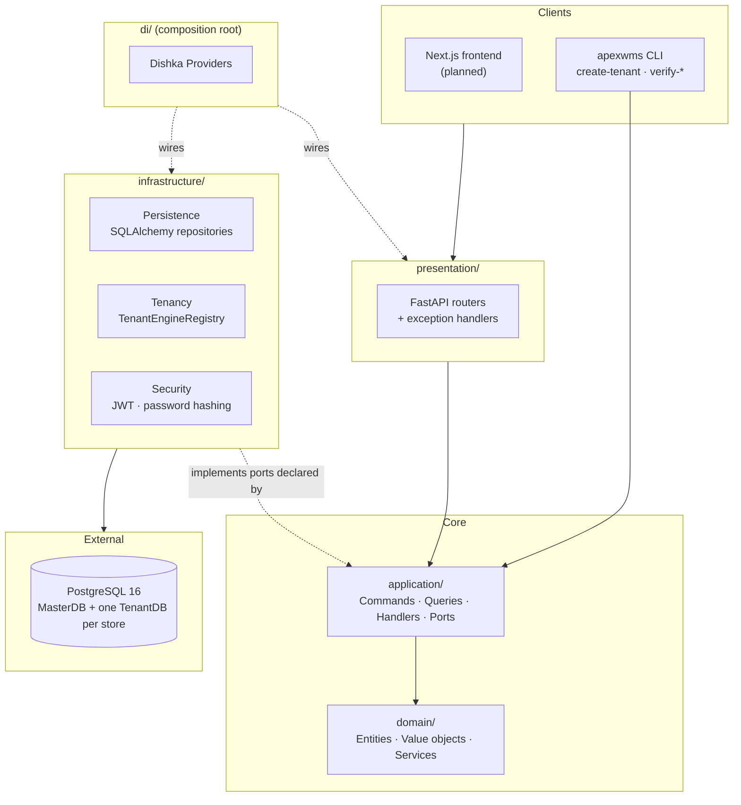

# Architecture Overview

ApexWMS is a multi-tenant (database-per-tenant) warehouse management system for phone stores, built as a Clean Architecture / CQRS backend on FastAPI. Full spec: [docs/prd.md](../prd.md).

> See [clean-architecture.md](clean-architecture.md) for the layer rule and flat `src/` layout. See [multi-tenancy.md](multi-tenancy.md) for the MasterDB/TenantDB split and DI scopes.

## System architecture

## Layered design

`presentation → application → domain`, with `infrastructure` implementing ports that `application` declares as `Protocol`s, and `di/` as the only package allowed to import from every layer. Detail: [clean-architecture.md](clean-architecture.md).

### Architecture enforcement

Layering and multi-tenancy invariants are enforced by tests, not just convention:

- `tests/architecture/test_database_split.py` — MasterDB/TenantDB identity split ([multi-tenancy.md](multi-tenancy.md))
- `tests/architecture/test_repository_bases.py` — the two-base repository rule ([ledgers.md](ledgers.md))
- `uv run ty check` — the `NewType`-wrapped `MasterSession`/`TenantSession` distinction; this is the only thing that catches a session handed to the wrong database, so a red `ty check` is a broken build

## Tech stack

| Technology            | Purpose                                        |
| ---------------------- | ---------------------------------------------- |
| FastAPI                 | Web framework                                  |
| Dishka                  | DI container (`APP`/`REQUEST` scopes)          |
| SQLAlchemy 2.x (async)  | ORM, via `asyncpg`                             |
| Alembic                 | Migrations                                     |
| Pydantic 2 / pydantic-settings | CQRS message layer, settings            |
| PyJWT                   | Access/refresh token issuance                  |
| argon2-cffi              | Password hashing                             |
| PostgreSQL 16            | Database (one MasterDB + one DB per tenant)  |
| fpdf2                    | Document PDFs (PRD §11 records why, not WeasyPrint) |
| pytest + pytest-asyncio  | Test suite (`asyncio_mode = "auto"`)         |
| testcontainers           | Postgres-backed integration tests            |
| ruff                     | Lint (does not type-check)                   |
| ty                       | Type checker — the real gate, see above      |

## Design patterns

### CQRS

One `Command`/`Query` per file under `application/commands|queries/`, each with exactly one `IRequestHandler`, dispatched without a MediatR-style pipeline (no cross-cutting behaviours yet — validation and authorization happen in `presentation/` and inside the handler itself). See [.claude/feature-map.md](../../.claude/feature-map.md) for which files belong to which feature area, and [clean-architecture.md](clean-architecture.md) for the message/response-model split.

### Ports and adapters

Every collaborator a handler needs (`UserRepository`, `UnitOfWork`, `Clock`, ...) is a `Protocol` declared in `application/ports/`; `infrastructure/` supplies the SQLAlchemy/JWT/etc. implementation. This is what lets `application/` be tested with in-memory fakes and no database.

### Append-only ledgers + projections

`stock_movements` and `financial_transactions` are the only source of truth for stock and money; every other field that looks like state (`stock_levels.quantity`, `device_units.status`, prices) is a projection recomputed from the ledgers in the same transaction that appends to them. See [ledgers.md](ledgers.md).

### Document lifecycle

All six document types share one `DRAFT → CONFIRMED → CANCELLED` lifecycle from a common `Document` base; each subclass states its own confirm invariants, and three of them render to a PDF. See [documents.md](documents.md).

## Next steps

- [clean-architecture.md](clean-architecture.md) — layer rule, flat `src/` layout
- [multi-tenancy.md](multi-tenancy.md) — database isolation, DI scopes
- [tenant-resolution.md](tenant-resolution.md) — request-time tenant resolution
- [value-objects.md](value-objects.md) — `Money`, `IMEI`, `CostPool`
- [ledgers.md](ledgers.md) — the two ledgers, repository bases, verification
- [documents.md](documents.md) — document lifecycle, and the three that print
- [milestones.md](milestones.md) — delivery status (PRD §10)
